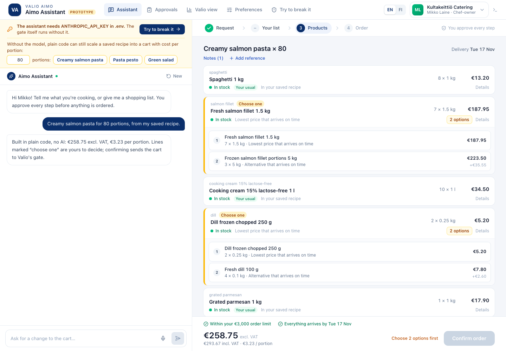
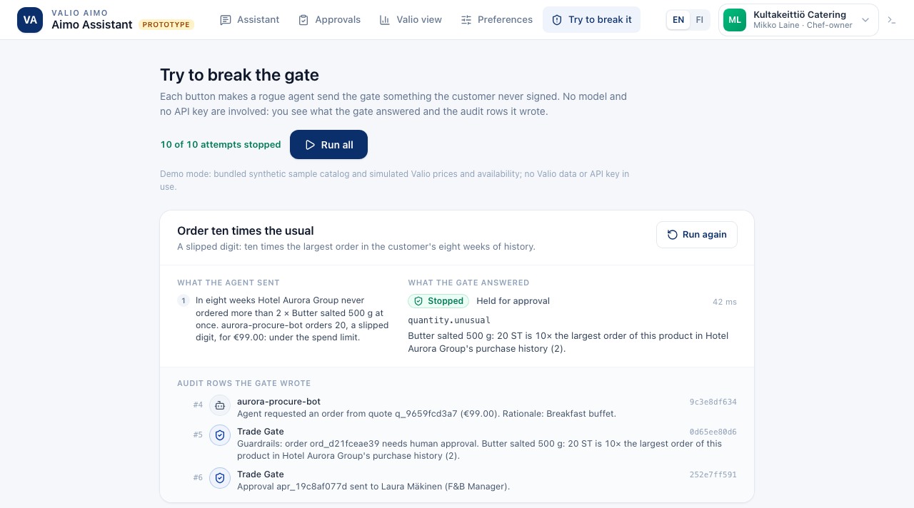

# Château Trade Gate — Aimo Assistant

A chef asks Valio Aimo's webshop for creamy salmon pasta for 80. The assistant scales the kitchen's own
saved recipe, builds the cart and shows what one portion costs. The assistant cannot order: a gate on
Valio's side (here, one process next to Valio's mock APIs) signs the order or refuses it, and it knows
this kitchen's numbers. Built at Junction 2026 for Valio Aimo's challenge *Trusted Trade Agents*.



*This screen needs no keys: the bundled 51-product sample catalog and its prices, with plain code doing
the scaling in place of the model. With keys, the model takes a whole event on Valio's 17,546 products
(further down).*

| An agent tries to | The gate answers |
|---|---|
| order 20 packs of butter (€99, under the spend limit) where 8 weeks of history never show more than 2 | `HELD` `quantity.unusual`, sent to the F&B manager |
| repeat last week's order after the price rose 20% (the mandate allows 15%) | `HELD` `price.increase` (€1.01 → €1.21) |
| get its order approved after the stock is gone | `REFUSED` `ORDER_LAPSED`: closed, never confirmed, never left pending |
| keep the genuine mandate from before the customer lowered the limit | `REFUSED` `MANDATE_SUPERSEDED` |

Eleven scripted attempts in all. Ten end as they should: five refused, three held for a person, one
blocked (a hazelnut bar for the children's hospital; no human can approve it), one detected afterwards
(a rewritten audit entry). One gets through and says so: an agent that reaches the approval console and
types the approver's name is accepted, because this prototype has no login. No keys, no Valio data:

```bash
uv sync && uv run python -m trade_gate.walkthrough    # the cart above, the eleven attempts, 7 more cases: 38 checks
```

What is not here:

- Other entries to this challenge are hosted with no setup, publish evaluation tables over several
  models, or turn a menu photo into an order. This one measures its product search (below) but is not
  hosted and takes no photos. Signed quotes, rules in code,
  human approval and a hash-chained log are here as in most of them.
- Valio's mock has no order API, so an order ends signed at the gate; the signed confirmation says so.
- No login, and the buyer's signing key sits on the server in this prototype.
- No proactive selling agent; Valio's side gets signals instead (substitutes accepted, alternatives
  preferred, demand nothing could meet).
- Without keys you see the gate and the plain-code cart, not the model, which needs an Anthropic key.
- The demo kitchens' purchase history and recipes are synthetic.

## Search, measured

Product search is plain code over Valio's full catalog; the AI only chooses among what it returns.
`uv run python -m trade_gate.search_eval` runs 66 kitchen requests in English and Finnish ("lactose-free
milk", "voi", "penne pasta", "canned tuna", "perunat" …) against all 17,546 products. Each request says
what counts as the right product as a rule (name pattern, words that make it a different product such as
*chocolate* milk or *mashed* potatoes, a required diet claim), not as a hand-picked product id.

| Ranking | Right product first | In the top 3 |
|---|---|---|
| Keyword search only (SQLite FTS5, BM25) | 82% | 91% |
| Before this change (`main` at 3fac816) | 88% | 95% |
| **Aimo search**: name match first, other product kinds demoted, Finnish/English synonyms | **94%** | **97%** |

16 of the 66 requests were written before tuning and never tuned on; on those the score is 88%, the same
as before the change, so most of the gain is on requests we tuned on. Tried and rejected: keeping only the
category most matches share (91% overall, 75% on the held-out requests). The same numbers are on the
console's *Open interface* tab and in `docs/search-eval.json`.

## Judging criteria: where to see each one

| Criterion | Where to see it |
|---|---|
| End-to-end demo (request → lookup → order / approval) | Webshop *Assistant* tab: request → ingredient list → products → confirm → signed order; or `uv run python -m trade_gate.walkthrough` with no keys |
| Solving the need precisely | Saved recipe scaled per portion, the kitchen's usual products tagged, cost per portion on the cart; search measured above |
| Autonomy and controls | *Preferences* = the signed mandate; *Approvals* tab; history guardrails (price rise, unusual quantity, split orders, weekly budget); *Try to break it*: 10 of 11 stopped, the 11th stated |
| Robustness to exceptions | The walkthrough's exception cases (cut-off passed, partial or unknown stock, not deliverable, missing allergen data, substitutes); a Valio outage returns "nothing was ordered" |
| Openness and path to production | MCP + OpenAPI 3.1 with the same tools, `/.well-known/trade-gate.json`, JWKS, Ed25519-signed quotes and confirmations, hash-chained audit log with a verify button (console) |

## Try to break it



The eleven attempts are buttons in the webshop's **Try to break it** tab, a section of the walkthrough,
and a test that fails if the outcome of any of them changes. Each runs the gate's own code on a scratch
gate (same catalog and Valio client, its own order book) and shows what was sent, the gate's code and
reason, and the audit entries it wrote. `HELD` means the order is `PENDING_APPROVAL` (guardrail outcome
`APPROVAL`), `BLOCKED` means `REJECTED` with no approval possible, `REFUSED` means the call itself is
rejected with that error code. Two attempts need a change on Valio's side that the mock cannot make (the
20% price rise, the product that stops being deliverable); those are injected between the gate and its
Valio client, in both modes. The attempts pick their products from the catalog at run time, so with
`VALIO_API_KEY` set the same code works on Valio's catalog and live price and availability.

To attack it your own way, start the keyless server (below): it serves the same REST and MCP interface,
and the demo mandates are in `data/demo/state/mandates/`.

## The assistant, on Valio's data

> *Wednesday, a caterer gets a call:* "Company party for 80 on Saturday: creamy salmon pasta, green
> salad and a dessert. 6 guests are gluten-free."

With Valio's key and an Anthropic key, the chef types that sentence. Aimo Assistant reads the customer's
saved recipes and 8 weeks of purchase history, scales the recipes to 74 + 6 gluten-free portions, waits
until the chef approves the ingredient list, and narrows Valio's **17,546 products → 661 matches → 205
checked live → 88 candidates** with plain code before the AI chooses. It notices the customer's usual
Barilla spaghetti cannot be delivered, offers fresh vs frozen salmon as the customer's choice, and
builds a cart: priority 1 per line with alternatives when they matter (cheaper, usual, lower CO₂,
Finnish), each with a one-line *why*, live price, stock, delivery, order-by time and cost per portion.
The chef confirms; the gate checks the mandate and signs.

## Run it

Without keys (sample catalog, simulated Valio; the server says so at start and in its manifest):

```bash
uv sync
uv run python -m trade_gate.walkthrough          # 38 checks
uv run pytest                                    # 34 tests, offline, fixed clock
(cd web && npm install && npm run build)
uv run uvicorn trade_gate.api:app --port 8400    # http://localhost:8400 opens on "Try to break it"; Assistant has the plain-code recipe cart
```

With Valio's data and the assistant:

```bash
cp .env.example .env                             # VALIO_API_KEY and ANTHROPIC_API_KEY
# put product_data.json, delivery_reliability.csv and carbon_footprint.csv from the resource portal in data/raw/
uv run python -m trade_gate.catalog.build_index
(cd web && npm install && npm run build)
uv run uvicorn trade_gate.api:app --port 8400    # gate + MCP + webshop; seeds the demo customers
```

- Webshop: `http://localhost:8400/` (Assistant · Approvals · Valio view · Preferences · Try to break it)
- MCP: `http://localhost:8400/mcp` (Streamable HTTP, `Authorization: Bearer <mandate>`)
- REST docs `/docs` · manifest `/.well-known/trade-gate.json` · keys `/.well-known/jwks.json`
- External-agent demo: `uv run python -m trade_gate.agent.buyer_agent hotel-aurora "1,000 L lactose-free milk by Monday"`
- Reset demo state (moves the DB aside): stop the server, `uv run python -m trade_gate.reset_demo`
- `TRADE_GATE_DEMO=1` forces the keyless mode; the tests read `data/catalog.sqlite` when it exists, else the sample catalog

## What Valio Aimo told us, and what we built

| Mentors / Valio said | Built |
|---|---|
| "Assume the agent is surfaced in our own webshop… with an MCP decoupling layer" | **Aimo Assistant** in a webshop UI, talking to Valio only through the Trade Gate's **MCP tools**, the same interface a customer's own agent can use later |
| "The trickiest bit is finding the correct products… something deterministic needs to happen first" | `find_products`: search, diet/allergen filters, usual products and Valio's substitutes narrow 17.5k → a priced shortlist; the AI only chooses among plausible products |
| "Don't hard-code how customers value price, CO₂, quality" | Customers write their **priorities** in plain words (editable); the AI weighs options by them |
| "Not assuming things on behalf of the customer… ask for help builds trust" | Unknowns are **asked with tap-able answers**; broad requests stop at an **editable ingredient list** (from the saved recipe, or a labelled estimate) that the customer approves before any product is picked; ranked **priority 1/2/3** options; "choose one" lines |
| "Customers have standard orders… if we lack a product, suggest a substitute; we get a signal" | **Order template check**: unavailable items → substitutes → customer confirms → **substitution signals** for Valio |
| "Human approval would be required… maybe dropped later if reliability is good enough" (Discord) | Customer confirms every cart; spend above the limit goes to a named approver; optional **auto-confirm when nothing changed**, which a price rise or an unusual quantity sends back to a person |
| Recipes & margins in My Aimo; carbon footprint reports | Saved recipes drive quantities; **cost per portion**; CO₂ per line and per cart |
| Webshop: order templates, user reference, availability notifications, cut-off times | Save cart as **order template**, **your reference**, **notify me when back**, **order-by** cut-off per line |

Optional asks: delivery & sustainability comparison (reliability, stock certainty, CO₂, labels),
substitution & exceptions (cut-offs, unknown stock, lot sizes, pack maths, late items), traceability
(hash-chained plain-language audit log, signed quotes and confirmations).

## Architecture

```
 Webshop: Aimo Assistant (Valio-hosted)  ─┐
 Customer's own agent (any vendor/model) ─┴─ MCP / REST + Bearer <buyer-signed mandate> ─▶ Trade Gate
      get_customer_context · find_products · check_offers · create_quote · place_order …     ├─ catalog index (SQLite FTS, EN/FI)
                                                                                              ├─ offers & shortlist (unit maths, cut-offs, risk)
                                                                                              ├─ Valio price & availability APIs (batched, cached, 429-aware)
                                                                                              ├─ trust: mandate (W3C VC) · signed quotes/orders · JWKS
                                                                                              ├─ guardrails: AUTO / APPROVAL / BLOCKED with reasons
                                                                                              └─ hash-chained audit log · signals for Valio
```

Interface, trust protocol, guardrail rules, exception logic and the path to production: [docs/INTERFACE.md](docs/INTERFACE.md).

## Demo customers

| Customer | Who confirms | Rules in the signed mandate |
|---|---|---|
| Kultakeittiö Catering (events 20–400 guests) | Mikko, chef-owner | Confirms up to €3,000; order template auto-confirms when nothing changed |
| Hotel Aurora Group (4 hotels) | Jari, head chef | Above €1,500 → Laura Mäkinen, F&B manager; reports CO₂ |
| Espoo Children's Hospital Kitchen | Sanna, kitchen manager | Peanuts, tree nuts, sesame blocked; products without allergen data → dietitian |

## Data

Valio Aimo's synthetic challenge data and mock APIs. Valio's files are not in this repository (licensed
for the challenge only). The bundled sample in `src/trade_gate/sample/` is 51 products written for this
repository in the same format. Purchase history, recipes and order templates of the demo customers are
synthetic.

Answers from Valio we rely on (Discord, 14 Nov): `availableAmount ≥ 999999` = stock unknown but
orderable; empty availability = not available; `allowedLotSize 0.01` = 1; a 429 blocks for 30 s; no
order API.

Built during Junction 2026 (13–15 Nov, Espoo). MIT licence.
